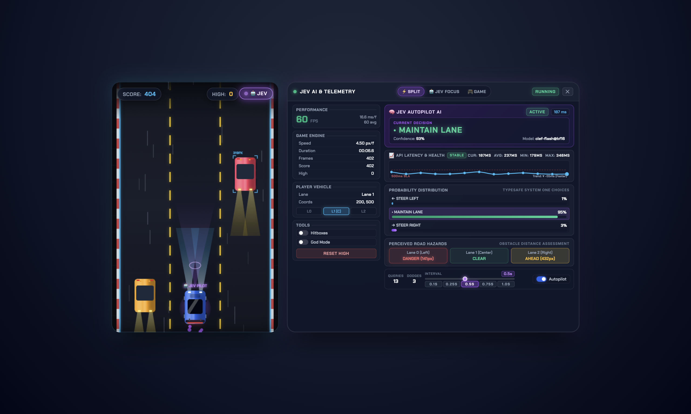
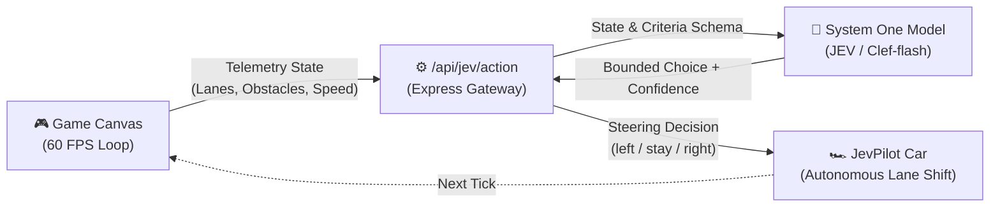
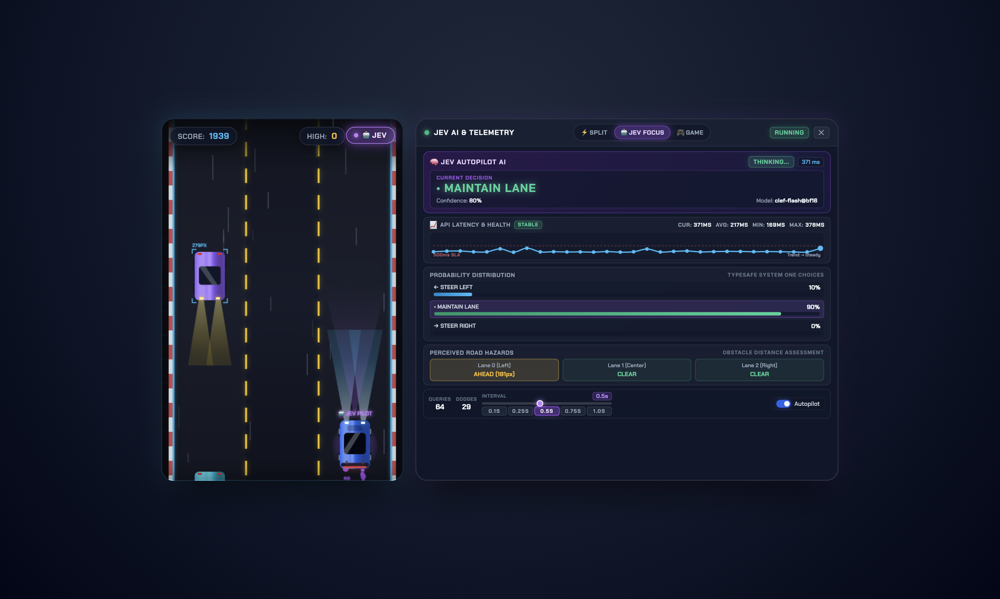

<div align="center">

```
     ___ _______    ______  ________   ____  ______ 
    /   / ____/ |  / / __ \/  _/ __ \ / __ \/_  __/ 
   / / / __/  | | / / /_/ // // / / // / / / / /    
  / / / /___  | |/ / ____// // /_/ // /_/ / / /     
 /_/ /_____/  |___/_/   /___/\____(_)____/ /_/      
```

# 🏎️ JevPilot

### Real-Time Autonomous Highway Runner powered by JEV & Clef System One Decision Models

[](https://nodejs.org/)
[](https://huggingface.co)
[](https://github.com/vijayprasath99/jev-pilot)
[](https://www.chartjs.org/)
[](LICENSE)

<br/>

<p align="center">
  
</p>

**JevPilot** is a high-speed 2D infinite highway runner and real-time developer telemetry laboratory. Instead of relying on slow token-by-token generative LLMs, JevPilot showcases **System One Decision Models** (**Jev** by TypeSafe AI or **Clef / Clef-flash** by Cloudflare) executing fast, single-forward-pass bounded judgments to dodge oncoming traffic at 60 FPS.

[Features](#-features) • [Preview](#-telemetry-focus-view) • [How It Works](#-how-it-works) • [Supported Models](#-supported-models) • [Quickstart](#-quickstart) • [Configuration](#-configuration) • [Telemetry & SLA](#-developer-telemetry--sla-tracking) • [Controls](#-controls--hotkeys)

</div>

---

## ⚡ Why System One Decision Models?

Traditional LLMs generate text token-by-token, taking **1,000ms – 3,000ms** with unpredictable formatting and hallucinations—making them unviable for real-time physics loops.

**Jev & Clef** embody Daniel Kahneman's **System 1 cognitive paradigm**:
- **Single Forward Pass:** Evaluates game state and pre-defined steering choices in parallel.
- **Zero Hallucination:** Directly outputs calibrated confidence scores across strictly typed options (`stay`, `left`, `right`).
- **Sub-Second Execution:** Delivers authoritative steering decisions in **tens to hundreds of milliseconds**, safely dodging hazards at high highway velocities.

---

## 🌟 Features

- 🤖 **Autonomous AI Autopilot:** Continuously observes lane obstacles, formulates safety criteria, and steers the car.
- 📊 **Real-Time Telemetry Dashboard:**
  - Live **Chart.js** latency sparkline updating with every decision.
  - Model confidence gauges, choice distribution, and selected steering actions.
  - Visual 3-lane hazard grid showing exact distances and threat levels (*CLEAR*, *APPROACHING*, *CRITICAL DANGER*).
  - Dynamic SLA tracking (`STABLE < 320ms`, `ELEVATED 320-500ms`, `DEGRADING > 500ms`).
- 🎮 **Seamless Hybrid Control:** Switch between autonomous autopilot and manual keyboard input at any millisecond with instant override.
- 🛡️ **Developer Sandbox & God Mode:** Toggle invulnerability shields, adjust polling frequency (100ms – 1000ms), and inspect decision payloads.
- 📐 **Multi-View Cockpit:**
  - **Split View:** Side-by-side game canvas and telemetry dashboard.
  - **JEV Focus View:** Maximized telemetry for model benchmarking.
  - **Game View:** Distraction-free arcade experience.
- 🚀 **Zero-Build Architecture:** Pure native ES6 modules served over Express with zero transpilation or bundle steps.

---

## 🔄 How It Works



1. **State Sampling:** Every tick interval (default: 500ms, down to 100ms), the frontend engine measures obstacle distance across all three lanes.
2. **Dynamic Criteria Generation:** The backend synthesizes typed choices based on current lane boundaries (preventing off-road steering).
3. **Single Forward-Pass Scoring:** The model evaluates danger vectors and returns choice probabilities.
4. **Autonomous Execution:** The vehicle executes the safest maneuver while the dashboard logs latency, confidence, and SLA status.

---

## 🧠 Supported Models

JevPilot works with any endpoint exposing the **System One API** specification (`/v1/systemone`):

| Model | Provider | Description |
| :--- | :--- | :--- |
| **Clef-flash** | Cloudflare | Ultra-fast multimodal 9B decision model optimized for sub-100ms inference (`clef-flash`, `clef-flash@bf16`, `clef-flash@q8_0`). |
| **Clef** | Cloudflare | 27B parameter decision model for high-complexity structural reasoning. |
| **JEV** | TypeSafe AI | The foundational System One decision model by TypeSafe AI. |

---

## 🚀 Quickstart

### Prerequisites
- [Node.js](https://nodejs.org/) (v18.0.0 or higher)
- A running **JEV** or **Clef** System One endpoint

### 1. Clone the Repository
```bash
git clone https://github.com/vijayprasath99/jev-pilot.git
cd jev-pilot
```

### 2. Install Dependencies
```bash
npm install
```

### 3. Configure Environment
Copy the example configuration:
```bash
cp .env.example .env
```

Edit `.env` to point to your System One endpoint and model:
```env
PORT=3000
JEV_ENDPOINT=http://localhost:1234/v1/systemone
JEV_MODEL=clef-flash
JEV_API_KEY=your-api-key-here
```

### 4. Launch JevPilot
```bash
# Start server
npm start

# Or with live file watching (development)
npm run dev
```

Navigate to **`http://localhost:3000`** in your browser.

---

## ⚙️ Configuration Reference

| Environment Variable | Default Value | Description |
| :--- | :--- | :--- |
| `PORT` | `3000` | Port for the Express server and frontend client. |
| `JEV_ENDPOINT` | `http://localhost:1234/v1/systemone` | HTTP endpoint hosting the System One decision API. |
| `JEV_MODEL` | `clef-flash` | Identifier for the decision model (e.g. `clef-flash`, `clef-flash@bf16`, `clef-flash@q8_0`, `jev`). |
| `JEV_API_KEY` | `lm-studio` | Authentication key / token required by your endpoint provider. |

---

## 📊 Developer Telemetry & SLA Tracking

<p align="center">
  
</p>

The right-hand cockpit panel tracks the health and reaction time of the decision pipeline:

```text
┌────────────────────────────────────────────────────────┐
│  🟢 JEV AUTOPILOT ACTIVE          SLA: STABLE (84ms)   │
├────────────────────────────────────────────────────────┤
│  Lane 0 [Left]   : 🟢 CLEAR                            │
│  Lane 1 [Center] : 🔴 CRITICAL DANGER (140px)          │
│  Lane 2 [Right]  : 🟡 APPROACHING (320px)              │
├────────────────────────────────────────────────────────┤
│  Model Choice    : STEER RIGHT                         │
│  Confidence      : 96.4%                               │
│  Rolling Latency : [===▅▃▂ ▂▃▅===] 84ms AVG            │
└────────────────────────────────────────────────────────┘
```

- 🟢 **STABLE (< 320ms):** Smooth highway dodging without latency degradation.
- 🟡 **ELEVATED (320ms – 500ms):** Approaching safe reaction time buffer; warnings flagged.
- 🔴 **DEGRADING (> 500ms):** SLA breach; vehicle may struggle to dodge high-velocity obstacles.

---

## 🕹️ Controls & Hotkeys

| Key | Action |
| :--- | :--- |
| <kbd>←</kbd> / <kbd>A</kbd> | Steer Left (manual override) |
| <kbd>→</kbd> / <kbd>D</kbd> | Steer Right (manual override) |
| <kbd>J</kbd> or <kbd>`</kbd> | Toggle **JEV Autopilot** ON / OFF |
| <kbd>Space</kbd> or <kbd>Esc</kbd> | Pause / Resume game |

---

## 🧪 Testing

Run the automated test suite verifying prompt engineering, dynamic choice boundaries, and AABB physics collisions:

```bash
npm test
```

---

## 📄 License

This project is licensed under the [ISC License](LICENSE).
